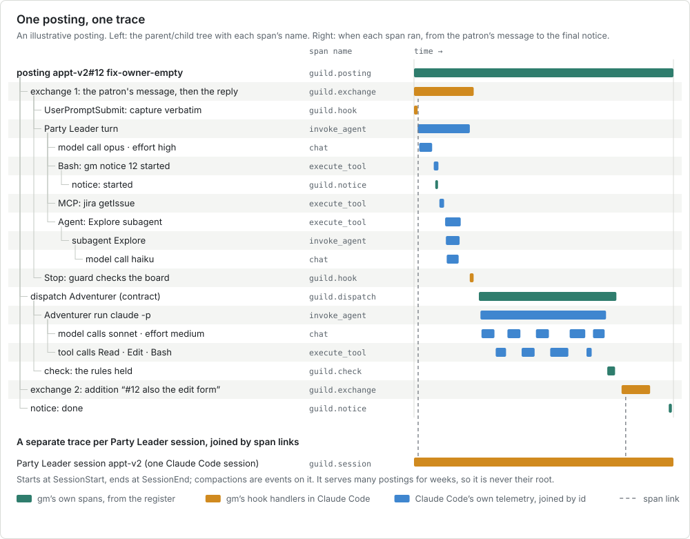

# Tracing design

How Guildmaster traces its work: one posting as one trace, built from the register, Claude Code's hooks and Claude Code's own telemetry, and kept on the patron's machine.
It answers the patron's request of 2026-09-30, quoted below, and requirements 6.1 to 6.4 in [requirements.md](requirements.md).
The landscape it rests on (standards, what Claude Code emits, tracing tools, how other orchestrators trace, and a local test of Claude Code 2.1.286) is in [tracing-research.md](tracing-research.md); a claim here without its own link is sourced there.
Vocabulary is [TERMINOLOGY.md](../TERMINOLOGY.md)'s.
Three habits taken from the study of Honeycomb, whose lessons are in [honeycomb/lessons.html](../honeycomb/lessons.html), are folded in: one complete row per span with an open attribute set ([Storage](#storage-and-viewer)), identifying details on every span with every measure a query ([Guild attributes](#guild-attributes), [Derived measures](#derived-measures)), and `gm stats --compare` ([Comparing a selection](#comparing-a-selection)).
Nothing here is built yet; [the build plan](#build-plan) says in what order it would be.

## The patron's words

As relayed on 2026-09-30, unedited:

> So for tracing i need to be able to see everything so called a mcp tool called another agent it created an agent it added a task the user wrote something how long did it take for the reply how many steps did it take for success maybe this i could determine by the information there so if there was multiple back and forth for the same topic. started a new party leader, that party leader started new crews, there was a hook that got initiated, there was a every type of event possibly. If there was a different type of model agent for each one of those traces, what was the effort level, what was the model
>
> kind of want to look into what's currently out there, how they're doing it, what they're picking up on, and do that research and let's determine what's the best way of tracing. I think that should be our next step.

"Crews" are Adventurers and "a task" is a posting, in TERMINOLOGY.md's words.

| The patron wants to see | Where in this design |
| --- | --- |
| The patron wrote something | `guild.exchange` span, started by the capture hook |
| It added a task | `guild.posting` span, the root of the trace |
| How long the reply took | [Time to first reply](#derived-measures) |
| Back and forth on the same topic | Exchanges per posting and per topic (`--follows`) |
| How many steps to success | [Steps to success](#derived-measures) |
| A new Party Leader started | `guild.session` span |
| The Party Leader started Adventurers | `guild.dispatch` and `invoke_agent adventurer` spans |
| It created an agent, called another agent | `execute_tool Agent` with its `invoke_agent` subagent span |
| An MCP tool was called | `execute_tool mcp__<server>__<tool>` span |
| A hook ran | `guild.hook` span, plus Claude Code's own hook events |
| The model and effort level of each | `gen_ai.request.model` and `gen_ai.request.reasoning.level` on every model call and every agent span |
| Every type of event | [Spans](#spans) and [Where each signal comes from](#where-each-signal-comes-from) |

## Principles

1. **A posting is a trace.** The trace id is minted when the patron's message becomes a posting and is stored on the posting's row; every later span about that posting carries it. This is the consultation's recommendation (section 6) and requirement 6.4.
2. **A Party Leader session is never a posting's root.** One session serves many postings for weeks, so it gets its own trace and is joined to the postings it served by span links. Firstmate learned the same: adopting a long-lived supervisor's trace "would chain every routed task into one ever-growing trace" (`docs/trace-context.md:46-47` in the Firstmate repository).
3. **The register is the record; a viewer is a view.** Spans are rows in the register beside the ledgers, so the history outlives any viewer and `gm trace` needs no other software.
4. **Claude Code's own telemetry is the per-call truth.** Model, effort, tokens, cost, retries and time to first token come from its `api_request` events and `llm_request` spans. `gm` does not re-derive them from transcripts, whose format "is internal to Claude Code and changes between versions" and whose repeated entries per message made another tool record only 20.8% of cache-read tokens.
5. **Local by default.** Telemetry goes only to `127.0.0.1`; prompts, responses and full command text are captured, secret patterns are redacted before storage, and identity attributes are dropped before storage. Prompts and work code are company material, so they never leave the machine.
6. **Standard names where they exist.** Agent, model-call and tool spans use the OpenTelemetry GenAI names (`invoke_agent`, `chat`, `execute_tool`, `gen_ai.*`); everything Guildmaster-specific is `guild.*`. The GenAI conventions are all in Development status, with no release to pin, so `gm` names the commit of `open-telemetry/semantic-conventions-genai` it follows (`b31e9e8`, 2026-09-30) and expects renames.
7. **Every measure is a query.** No count, total or duration is stored beside the spans; time to first reply, steps, cost and the rest are computed from span rows when asked, so a new measure never needs a migration or a backfill. This is principle 3 in the terms of Honeycomb's rule that "any aggregation that is performed at write time is actively harmful" ([honeycomb/lessons.html](../honeycomb/lessons.html#cardinality)).
8. **Tracing never stops work.** A span that cannot be written is dropped and counted; no hook blocks and no dispatch fails because of tracing.

## The span tree



The figure is one illustrative posting, `appt-v2#12 fix-owner-empty`, from the patron's first message to its final notice.
Green spans are `gm`'s own, orange ones are written by `gm`'s hook handlers, and blue ones come from Claude Code's telemetry and are joined into the posting's trace by id.
Each exchange holds the capture hook, the Party Leader's turn and the Stop hook; the turn holds its model calls and tool calls, and a call to the `Agent` tool holds the subagent's run with its own model calls.
A dispatch holds the Adventurer's run and the rules check that follows it.
The Party Leader's session is a separate trace, linked to each exchange it served.

The same tree as text, which is also what `gm trace` prints (times are illustrative):

```
appt-v2#12 fix-owner-empty  done  2h14m  3 exchanges  $1.92
├─ exchange 1  "the owner field is empty after save, fix it"  reply in 41s
│  ├─ hook UserPromptSubmit  capture                         0.1s
│  ├─ invoke_agent party-leader  opus-5-5 · high             38s
│  │  ├─ chat opus-5-5 · high  in 31k (cached 29k) out 1.2k  $0.21  9.0s
│  │  ├─ execute_tool Bash  gm notice 12 started              0.4s
│  │  │  └─ notice started
│  │  ├─ execute_tool mcp__jira__getIssue                     1.8s
│  │  └─ execute_tool Agent  Explore                           14s
│  │     └─ invoke_agent Explore  haiku-4-5                    13s
│  │        └─ chat haiku-4-5  in 12k out 0.9k  $0.02         11s
│  └─ hook Stop  pass                                        0.2s
├─ dispatch contract  writ 3e1f…  sonnet-5-5 · medium         1h31m
│  ├─ invoke_agent adventurer  14 model calls · 22 tool calls  $1.41
│  └─ check  pass
├─ exchange 2  "#12 also the edit form"  reply in 12s
└─ notice done
```

## Spans

| Span name | Starts | Ends | Parent | Written by | Key attributes |
| --- | --- | --- | --- | --- | --- |
| `guild.posting` | The capture hook or `gm post` creates the posting | Its terminal notice: `done`, `failed` or `closed` | none (root) | `gm` | `guild.focus`, `guild.posting`, `guild.posting.slug`, `guild.state`, `guild.follows` |
| `guild.exchange` | A patron message about this posting is captured: the posting itself or an addition | The `Stop` that lets the turn which answered it end (same `session.id` and `prompt.id`); a `Stop` the guard blocks is only a `guild.hook` span | `guild.posting` | hooks | `guild.message.id`, `guild.message.kind`, `guild.exchange.n`, `session.id`, `prompt.id` |
| `guild.hook` | A `gm hook` handler starts | It returns | The exchange, or `guild.session` for session hooks | hooks | `guild.hook.event`, `guild.hook.decision` (`allow`, `block`, `none`), `guild.hook.blocks` |
| `invoke_agent party-leader` | The Party Leader's turn starts | The turn's `Stop` | The exchange; a turn woken by a summons hangs under the posting it is about | Claude Code (`claude_code.interaction`), or the hooks when telemetry is off | `gen_ai.operation.name=invoke_agent`, `gen_ai.agent.name`, `gen_ai.conversation.id` (the session id), `gen_ai.request.model`, `gen_ai.request.reasoning.level`, `guild.role` |
| `chat <model>` | A model API call starts | It returns, retries included | The turn, or the `Agent` tool span for a subagent's call | Claude Code (`claude_code.llm_request` span, `claude_code.api_request` event) | `gen_ai.operation.name=chat`, `gen_ai.provider.name=anthropic`, `gen_ai.request.model`, `gen_ai.response.id`, `gen_ai.response.finish_reasons`, `gen_ai.usage.input_tokens`, `gen_ai.usage.output_tokens`, `gen_ai.usage.cache_read.input_tokens`, `gen_ai.usage.cache_write.input_tokens`, `gen_ai.request.reasoning.level`, `guild.cost.usd`, `guild.ttft_ms`, `guild.attempt`, `error.type` |
| `execute_tool <tool>` | A tool call starts (after any permission wait) | It returns | The turn, or a subagent | Claude Code (`claude_code.tool`), and the `PreToolUse` and `PostToolUse` hooks | `gen_ai.tool.name`, `gen_ai.tool.call.id` (Claude Code's `tool_use_id`), and for MCP tools `mcp.method.name=tools/call` and `guild.mcp.server`; `guild.tool.command`, `error.type` |
| `invoke_agent <subagent>` | `SubagentStart` | `SubagentStop` | The `execute_tool Agent` span that started it | Claude Code (spans carry `agent_id`), and the subagent hooks | `gen_ai.agent.name` (`agent_type`), `agent_id`, `gen_ai.request.model`, `guild.background` |
| `guild.notice` | A `gm notice`, `gm park` or `gm phase` call starts | It returns | The `execute_tool` span of the Bash call that ran it (from `TRACEPARENT`, or else the session's open Bash call recorded by `PreToolUse`), otherwise the posting | `gm` | `guild.notice.verb`, `guild.state`, `guild.phase` |
| `guild.dispatch` | `gm dispatch` starts an Adventurer (build step 3) | The Adventurer exits and its result is recorded | `guild.posting` | `gm` | `guild.dispatch.kind` (`contract`, `survey`), `guild.writ.sha256`, `gen_ai.request.model`, `gen_ai.request.reasoning.level`, `guild.exit_code`, `guild.cost.usd`, `guild.turns` |
| `invoke_agent adventurer` | The headless `claude -p` process starts | It exits | `guild.dispatch`, through `TRACEPARENT` | Claude Code, and `gm` when Claude Code sends no interaction span | `gen_ai.conversation.id` (the session id `gm` assigned), `gen_ai.request.model`, `gen_ai.request.reasoning.level`, `gen_ai.usage.reasoning.output_tokens` (the run's total) |
| `guild.check` | `gm check` starts after an Adventurer (build step 3) | It returns | `guild.dispatch` | `gm` | `guild.check.result` (`pass`, `fail`), `guild.check.rule` |
| `guild.session` | `SessionStart` with source `startup`, `resume` or `clear` (a `compact` start is an event on the open one) | `SessionEnd` | none: its own trace, linked to each exchange it served | hooks | `session.id`, `guild.focus`, `guild.role`, `guild.session.source`, `guild.session.end_reason`; compactions and guard give-ups as span events |

Only the hooks that decide or inject (`UserPromptSubmit` capture, the `Stop` guard, the `SessionStart` resume, the `PreCompact` snapshot) get `guild.hook` spans; the handlers that only record (`PreToolUse`, `PostToolUse`, the subagent hooks, `SessionEnd`, `StopFailure`) write the spans they describe and not one of their own, and every hook run, `gm`'s or not, still shows in Claude Code's `hook_execution_complete` events.

Retries and failures are not separate spans.
A failed model call, tool call, hook, check or posting sets its span's status to error with `error.type`; retries are `gen_ai.request.attempt` span events on the model call (Claude Code already emits them) and the `guild.attempt` count; a rate-limit stop (`StopFailure`) is an event on the turn; a failed check is an event on the posting, which reopens it.

The root is `guild.posting` rather than the conventions' `invoke_workflow`, although a posting is "a coordinated process composed of multiple agents": it lasts days, waits on the patron, and includes the patron's own messages, which no agent span describes.
The conventions also leave open whether a separate `claude -p` process is a CLIENT or an INTERNAL `invoke_agent` span; `gm` writes INTERNAL until they settle.

### Mapping Claude Code's names

`gm trace import` renames Claude Code's telemetry into the GenAI names, keeping the originals as a span link and Claude Code's own keys.

| Claude Code | GenAI convention or guild name |
| --- | --- |
| `claude_code.interaction` span | `invoke_agent party-leader` or `invoke_agent adventurer` |
| `claude_code.llm_request` span, `claude_code.api_request` event | `chat <model>` |
| `claude_code.tool` span, `claude_code.tool_result` event | `execute_tool <tool>` |
| `gen_ai.system=anthropic` (deprecated name) | `gen_ai.provider.name=anthropic` |
| `model` | `gen_ai.request.model` |
| `effort` | `gen_ai.request.reasoning.level`, the exact string sent |
| `input_tokens` + `cache_read_tokens` + `cache_creation_tokens` | `gen_ai.usage.input_tokens`, because Anthropic's `input_tokens` excludes cached tokens and the conventions' count includes them |
| `cache_read_tokens`, `cache_creation_tokens` | `gen_ai.usage.cache_read.input_tokens`, `gen_ai.usage.cache_write.input_tokens` (renamed from `cache_creation` on 2026-08-20, not yet released) |
| `request_id`, `stop_reason`, `tool_use_id` | `gen_ai.response.id`, `gen_ai.response.finish_reasons`, `gen_ai.tool.call.id` |
| `cost_usd`, `ttft_ms`, `attempt` | `guild.cost.usd`, `guild.ttft_ms`, `guild.attempt`: the conventions define no cost attribute |
| `agent_id`, `session.id`, `prompt.id` | Kept as they are. `agent_id` is not `gen_ai.agent.id`, which the conventions reserve for a stable id, not an in-memory one |

### Guild attributes

| Attribute | Type | Meaning |
| --- | --- | --- |
| `guild.focus` | string | The focus name, `appt-v2`. |
| `guild.posting` | string | The posting reference, `appt-v2#12`. Stamped on every span in the trace, so a posting can be found even in a viewer that only searches attributes. |
| `guild.posting.slug` | string | `fix-owner-empty`. |
| `guild.role` | string | `patron`, `guildmaster`, `party-leader`, `adventurer` or `gm`. |
| `guild.message.id`, `guild.message.kind` | int, string | The register's message row and what it became: `posting`, `addition`, `command`, `unplaced`. |
| `guild.exchange.n` | int | 1 for the message that made the posting, 2 for the first addition, and so on. |
| `guild.follows` | string | The earlier posting this one continues, set by the Party Leader with `--follows` ([Derived measures](#derived-measures)). |
| `guild.notice.verb`, `guild.state`, `guild.phase` | string | As in [step-1-design.md](step-1-design.md#postings-and-notices). |
| `guild.hook.event`, `guild.hook.decision`, `guild.hook.blocks` | string, string, int | Which hook, what it decided, and the Stop guard's block count. |
| `guild.cost.usd` | double | Claude Code's own cost estimate for the call or run. |
| `guild.ttft_ms`, `guild.attempt` | int | Time to first token and attempts, from Claude Code. |
| `guild.mcp.server` | string | The MCP server's name, from the hooks' `mcp_server.name`. |
| `guild.tool.command` | string | The full Bash command, or a file tool's path, with secret patterns redacted before it is stored; kept 30 days ([Retention and redaction](#retention-and-redaction)). |
| `guild.prompt.template`, `guild.prompt.sha256` | string | The name of the prompt template in force (`charter`, `playbook`, `resume`, `writ-contract`, `writ-survey`) and the hash of its rendered text, on the session, exchange and dispatch spans and on every span of an Adventurer run ([Prompt effectiveness](#prompt-effectiveness)). |
| `guild.follows.p` | double | The probability the local model gave that this posting continues the one in `guild.follows`, when the link began as a suggestion ([Follow-up suggestions](#follow-up-suggestions)). |
| `guild.background` | bool | A subagent or Adventurer that ran in the background. |
| `guild.dispatch.kind` | string | Contract or survey. |
| `guild.writ.sha256` | string | The hash of the rendered writ and its template (requirement 5.2). On the dispatch span and on every span of the Adventurer's run: its `invoke_agent`, model-call, tool-call and subagent spans, which `gm` stamps when it re-parents them at import by session id. |
| `guild.camp.commit` | string | The camp's `HEAD` commit (`git rev-parse HEAD` in the camp) when the span ended, so a slow or failed span can be tied to the code it ran against. Stamped on every span `gm` or its hooks write; a span imported from Claude Code's telemetry takes the commit last recorded for its session at or before its end. |
| `guild.exit_code`, `guild.turns` | int | From the Adventurer's process and its result. |
| `guild.check.result`, `guild.check.rule` | string | The rules check's outcome and the rule it found broken. |
| `guild.session.source`, `guild.session.end_reason` | string | `SessionStart`'s `source` and `SessionEnd`'s `reason`. |

These are the identifying details of [the Honeycomb study](../honeycomb/lessons.html#cardinality): the ids a metrics system drops are the ones that explain a bad run, so each goes on every span instead of being summed away.
`guild.posting`, `session.id`, `prompt.id`, `agent_id`, `gen_ai.tool.call.id`, `guild.writ.sha256` and `guild.camp.commit` are very-high-cardinality, and stay on every span for that reason.

Claude Code's own correlation keys keep their names: `session.id`, `prompt.id`, `agent_id`, and `tool_use_id` (as `gen_ai.tool.call.id`).

## Where each signal comes from

| Event | Source | How | Today |
| --- | --- | --- | --- |
| Patron message, posting received | `gm hook prompt` (`UserPromptSubmit`) | Already writes the message row with `session_id` and `prompt_id`; mints the trace id and starts `guild.exchange` | Message row built in step 1; span new |
| The reply and its latency | `gm hook stop` (`Stop`, which carries `prompt_id`) | Ends the exchange and the turn | New |
| Each back and forth | Additions (`#12 …`) captured by the hook; `--follows` for a follow-up written as a new message | Message rows and `guild.follows` | Additions built; `--follows` new |
| Party Leader started and ended | `SessionStart` (built), `SessionEnd` (new) | `guild.session` | Start event built; span new |
| Adventurer dispatched and finished | `gm dispatch` (build step 3) and the run's `--output-format stream-json` result | `guild.dispatch` from launch to exit; the result's cost, turns and per-model usage | Designed here, built with step 3 |
| Model calls, with model and effort | Claude Code's `api_request` events and `llm_request` spans (`model`, `effort`, four token counts, `cost_usd`, `ttft_ms`, `attempt`) | Imported into the register ([Storage](#storage-and-viewer)) | New; needs telemetry on |
| Model and effort without telemetry | The hooks' `effort.level` (tool-context events) and the status line's `model.id` and `effort.level` | `gm statusline` records them per `prompt_id` when they change | New |
| Tool calls, MCP calls | `PreToolUse` and `PostToolUse` (`tool_name`, `tool_use_id`, `duration_ms`, `mcp_server`), `PostToolUseFailure`; Claude Code's `tool` spans and `tool_result` events | `execute_tool` spans keyed by `tool_use_id` | New |
| Subagents | `SubagentStart` and `SubagentStop` (`agent_id`, `agent_type`, transcript path); the `Agent` tool's `PostToolUse` (resolved model, total tokens, tool uses); Claude Code's spans with `agent_id` and its `subagent_completed` event | `invoke_agent <subagent>` under the `Agent` tool span | New |
| Hook runs | `gm`'s own handlers time themselves; Claude Code's `hook_execution_start` and `hook_execution_complete` events cover every hook, `gm`'s or not | `guild.hook` spans; other hooks as events | New |
| Retries and failures | `api_error` (`attempt`), `api_retries_exhausted`, `gen_ai.request.attempt` span events; `StopFailure`; `PostToolUseFailure`; `failed` notices; `gm check` failures | Span status and events | New |
| Notices | `gm notice`, `gm park`, `gm phase` | Ledger rows (built) and `guild.notice` spans | Ledger built; span new |
| Compaction | `PreCompact` (built), `PostCompact`, Claude Code's `compaction` event (tokens before and after) | Events on `guild.session` | Snapshot built; event new |

### How the trace context travels

1. **The capture hook mints the trace.** When `gm hook prompt` creates a posting it stores a W3C trace id and the posting span's id on the posting row, from SQLite's `randomblob`. An addition reuses its posting's trace.
2. **Party Leader turns are joined, not parented.** Claude Code's interactive sessions "ignore inbound `TRACEPARENT`", so a Party Leader's native spans arrive in a trace of their own, one per turn. `gm` joins each turn to its exchange by `session.id` and `prompt.id`, which its message row already holds, and re-parents the turn's spans under the exchange when it imports them; the original ids are kept as a span link.
3. **`gm open` turns telemetry on for the session it starts.** It sets the exporter variables in the launched `claude` process's own environment, pointing at `127.0.0.1`, plus `OTEL_RESOURCE_ATTRIBUTES=guild.focus=appt-v2,guild.role=party-leader`, which Claude Code attaches to every metric and event. It cannot use the camp's `.claude/settings.local.json`, because since 2.1.282 Claude Code ignores export, destination and content variables in a repository's settings files.
4. **`gm` commands see the calling tool span.** Claude Code gives a Bash tool's subprocess `TRACEPARENT` set to that tool call's `claude_code.tool.execution` span (documented, and seen in the local test), so `gm notice` knows exactly which tool call ran it and hangs its `guild.notice` span there.
5. **Adventurers are parented through `TRACEPARENT`** (build step 3). `gm dispatch` mints the dispatch span, then launches `claude -p` with `TRACEPARENT=00-<posting trace>-<dispatch span>-01`, overwriting the Party Leader's own value rather than adopting it (Firstmate's rule); `--session-id` set to a UUID it has already recorded; `--model` and `--effort` explicit; the exporter variables set again, because Claude Code passes no `OTEL_*` variable to its subprocesses; and `OTEL_RESOURCE_ATTRIBUTES` naming the focus, posting and role. The headless run reads `TRACEPARENT` for its interaction spans. In the local test on 2.1.286 its log events did carry the posting's trace id, but its first prompt produced no interaction span, so `gm` writes the `invoke_agent adventurer` span itself and re-parents the run's spans by session id at import; each new Claude Code version is checked again.
6. **Hooks see the active context.** Hook processes received `TRACEPARENT` for the current interaction in the local test, and `SubagentStart` and `SubagentStop` received the `Agent` tool's span; `gm`'s hooks still key on the documented `session_id`, `prompt_id`, `tool_use_id` and `agent_id` fields in their input rather than on the environment.
7. **Subagents nest natively** under the `Agent` tool span, with `agent_id` on their spans.
8. **MCP calls are traced from Claude Code's side.** The MCP specification of 2026-07-28 reserves `traceparent` and `tracestate` in a request's `_meta` (SEP-414), but does not require clients to send them, and Claude Code does not: issues asking for it were closed unimplemented, and in the local test a stdio MCP server's `tools/call` `_meta` held only `claudecode/toolUseId` and a progress token; the server process inherited `TRACEPARENT` once, at start. HTTP MCP requests carry a `traceparent` header (documented, not tested). So an MCP call is the `execute_tool` span plus the hooks' `mcp_server` name, keyed by `tool_use_id`; a Guildmaster MCP server of its own could log `claudecode/toolUseId` and join on it.

### What cannot be captured today

| Gap | Why | What the design does instead |
| --- | --- | --- |
| Native parenting of Party Leader turns | Interactive sessions ignore `TRACEPARENT` | Join by `session.id` and `prompt.id` at import |
| The first interaction span of a headless run, and the last spans of a short run | Seen on 2.1.286: the first prompt had no interaction span, and spans still open at exit were lost (logs arrived) | `gm`'s own `invoke_agent` span; model calls from `api_request` events, which did arrive; check again per version |
| Hook spans from Claude Code | Only with "detailed beta tracing", which an interactive session can use only if the organisation is allowlisted | `gm`'s own hook spans, and Claude Code's hook events for every hook |
| Effort for `ultrathink`, and for a model that takes no effort | `ultrathink` "adds an in-context instruction"; the effort sent is unchanged. The local test's Haiku calls carried no effort | Record what Claude Code sent; show "none" |
| Thinking tokens | Not in Claude Code's telemetry | The Adventurer result's `modelUsage.thinkingTokens`; not available for Party Leader turns |
| MCP server-side spans | No trace context reaches a stdio server per call | Claude Code's side of the call only |
| Exact cost of a Party Leader turn that served several postings | A turn is one model conversation | Attribute it to the posting whose message started it, link the others, and label it "attributed" |
| The end of a killed session | Claude Code has no session-end event, and a killed process runs no `SessionEnd` hook | The muster closes open session spans as ended at the last seen time |
| The patron's own reading and typing time | Not visible to any hook | Reply latency ends when the turn ends |
| When a message typed during a running turn is captured | Not documented | To be checked in the build before "reply latency" is trusted for queued messages |
| Billing truth | Claude Code's cost is a client-side estimate, "not authoritative billing data" | Labelled as an estimate everywhere |

## Derived measures

All are queries over the register; `gm stats <posting|focus>` prints them, and `gm trace` heads each posting with the main ones.
None is stored: a posting's total time, step counts and cost are computed from its span rows each time, so a measure added later applies to every posting already traced.

| Measure | Definition |
| --- | --- |
| Time to first reply | From the capture of the posting's first message to the `Stop` of the turn that answered it. |
| Time to first notice | From capture to the first notice after `received`. |
| Total time | From `received` to the terminal notice; also working time (the union of turn and Adventurer spans) and parked time, shown apart. |
| Exchanges per posting | The patron's messages on it: the first plus each addition. |
| Exchanges per topic | The same, summed over a posting and every posting that `follows` it. A follow-up the patron writes without `#12` becomes a new posting; the patron or the Party Leader links it with `gm notice 13 queued --follows 12`, or accepts a [suggestion](#follow-up-suggestions), so the number stays true without renumbering anything. |
| Turns | Party Leader turns on the posting: its exchanges plus turns woken by summons about it. |
| Steps to success | For a posting that reached `done`: turns, model calls, tool calls (MCP apart), subagent runs, Adventurer runs, failed checks and retries. "Right first time" is `done` with one exchange, at most one Adventurer run and no failed check. |
| Tokens and cost per posting | The sum of the token counts and `guild.cost.usd` over the posting's model calls, split by model, by effort and by role. An Adventurer's is exact (its own session); a Party Leader turn's is attributed. |
| Hook overhead | Time in `gm`'s hooks per posting, and Stop-guard blocks. |
| Outcome per prompt version | For the postings that ran under one `guild.prompt.sha256`: how many reached `done`, how many were right first time, exchanges, failed checks, cost. See [Prompt effectiveness](#prompt-effectiveness). |

```
$ gm stats appt-v2#12
appt-v2#12 fix-owner-empty  done
  first reply 41s · first notice 9s · total 2h14m (working 1h43m, parked 0m)
  exchanges 3 (topic 4, with #15) · turns 5 · right first time: no (2 Adventurer runs)
  steps: 61 model calls · 48 tool calls (3 MCP) · 1 subagent · 2 Adventurer runs · 1 failed check · 0 retries
  cost $1.92 est.: opus-5-5/high $0.38 (party leader) · sonnet-5-5/medium $1.51 (adventurers) · haiku-4-5/none $0.03
```

### Prompt effectiveness

The patron "needs to eventually figure out which prompt works best" (relayed 2026-10-02), so every prompt Guildmaster hands a model is versioned and every posting's outcome is tied to the version it ran under.

- **What is versioned.** The charter, the ticket playbook and the repository's rules as loaded at `SessionStart`, the resume text `gm hook session-start` injects, the Stop guard's block message, and the writ and its template for each Adventurer (the hash requirement 5.2 already asks for). Each gets a name and the SHA-256 of its rendered text, recorded as `guild.prompt.template` and `guild.prompt.sha256` on the session, exchange and dispatch spans and, by the same stamping as `guild.writ.sha256`, on every span of an Adventurer run. The rendered text itself is stored once per hash in a `prompt_version` table (hash, name, first seen, text), so a hash can always be read back; an edit to a template is a new hash, never an overwrite.
- **What is compared.** `gm stats --by-prompt <template>` groups the postings that ran under each hash of that template and prints, per hash: postings, done, right first time, median exchanges, median steps, failed checks and median cost. It is a query over spans like every other measure, and `gm stats --compare` can already ask what separates postings under one hash from the rest.
- **What it cannot say.** A posting's difficulty, the model and effort, and the repository all move the outcome as much as the prompt does, so the output prints each group's size and its mix of model and focus beside the numbers, and `gm` does not rank hashes with fewer than 10 postings. It shows a difference; it does not prove a cause. The patron's own messages are stored word for word in the register, but the design makes no attempt to score the patron's phrasing.
- **Prompts as sent, not only as written.** With prompt and response capture on ([Retention and redaction](#retention-and-redaction)), the exact text the model received and returned for a call is in Claude Code's events, so a template can be checked against what it rendered into.

### Follow-up suggestions

"Back and forth on the same topic" needs postings tied together. The patron's answer to Q2 gives two ways ([Questions for the patron](#questions-for-the-patron)):

1. **The patron's tag.** `--follows` as designed, set by the patron (or the Party Leader on their word). It is the ground truth.
2. **A local model's suggestion, with a probability.** When a posting is created, a model that runs on the laptop compares it with the earlier postings and records the best candidates with a probability that each is the same topic. A suggestion never links anything by itself: `gm list` and `gm show` show "may continue appt-v2#12 (0.82)", and the link counts in [Exchanges per topic](#derived-measures) only once the patron or the Party Leader accepts it (`gm follows accept 13`). Suggestions go in a `follow_suggestion` table (posting, candidate, probability, model and version, state `suggested`, `accepted` or `rejected`, time); an accepted one sets `guild.follows` and `guild.follows.p` on the posting. Nothing is sent off the machine, and a missing model only means there are no suggestions.

A similarity score is not a probability. The number shown has to be calibrated: fit a logistic curve over the patron's own accepted and rejected pairs, or, with a small instruction model as judge, read the probability of the answer "same topic" from its token probabilities. Until enough pairs exist (about 30), `gm` shows the raw score labelled "score, not probability".

Candidates to evaluate, none yet tried on Guildmaster's postings; the names are from general knowledge of what runs offline, not checked for this design:

| Approach | Runs through | Notes |
| --- | --- | --- |
| Full-text similarity (TF-IDF or BM25) | SQLite FTS5 in the register | No model at all; the baseline every model must beat |
| Small embedding model (`nomic-embed-text`, `mxbai-embed-large`, `bge-m3`, `all-MiniLM`, EmbeddingGemma) | Ollama, or llama.cpp with a GGUF file | Cosine similarity of posting texts; cheap; needs calibration |
| Small reranker or cross-encoder (the `bge-reranker` family) | llama.cpp or an ONNX runtime | Scores a pair directly; better than cosine at the top of the list |
| Small instruction model as judge (a 1B to 8B model such as Llama 3.2, Qwen or Phi) | Ollama or llama.cpp | Can say why; slowest; probability from token probabilities |

The evaluation is the patron's tags themselves: for each tagged pair, does the approach put the true earlier posting in its top three, and at what threshold are suggestions right nine times in ten.
The patron's "a local ai one like JEV" is not identified: no local model or tool of that name is known to this design.
Which one was meant is a question for the patron, and the approach is chosen only after the table above has been tried.

### Comparing a selection

`gm stats --compare <selection>` asks what is different about the spans, exchanges or postings the patron picked.
It is the BubbleUp of [honeycomb/lessons.html](../honeycomb/lessons.html#bubbleup): for every attribute value, the share of the selection that has it against the share of everything else (the baseline), sorted by the largest difference.
The patron's questions are comparative: why a posting needed three exchanges when most need one, why some model calls are slow.
A selection is anything the measures above define: `chat` spans slower than 30 s, exchanges whose reply took over two minutes, postings not right first time, Adventurer runs whose check failed.

```
$ gm stats --compare 'chat spans slower than 30 s'          (illustrative)
key                              value        selection  baseline
gen_ai.request.model             opus-5-5        81.0%     22.4%
gen_ai.request.reasoning.level   high            77.9%     35.0%
guild.focus                      appt-v2         74.2%     30.1%
guild.role                       party-leader    69.0%     41.7%
guild.attempt                    2               18.3%      1.2%
```

It is one query over the `attrs` column, taken from the study and shown here for the slow-call selection (`sel` is 1 for a span in the selection and 0 for the baseline):

```sql
WITH s AS (
  SELECT (end_ms - start_ms) > 30000 AS sel, attrs
  FROM span WHERE name LIKE 'chat %'
),
tot AS (SELECT SUM(sel) AS n_sel, SUM(1 - sel) AS n_base FROM s),
kv  AS (SELECT s.sel, j.key, CAST(j.value AS TEXT) AS value
        FROM s, json_each(s.attrs) AS j)
SELECT key, value,
       ROUND(100.0 * SUM(sel)     / tot.n_sel,  1) AS pct_selection,
       ROUND(100.0 * SUM(1 - sel) / tot.n_base, 1) AS pct_baseline
FROM kv, tot
GROUP BY key, value
ORDER BY ABS(1.0 * SUM(sel) / tot.n_sel - 1.0 * SUM(1 - sel) / tot.n_base) DESC
LIMIT 10;
```

Honeycomb's scoring formula is not published, so this is the simplest version, not a copy.
Its own caveat applies: very-high-cardinality fields "may not have a meaningful 'baseline'", so `gm` leaves the ids out of the ranking: `guild.posting`, `guild.posting.slug`, `guild.message.id`, `session.id`, `prompt.id`, `agent_id`, `gen_ai.tool.call.id`, `gen_ai.response.id`, `guild.writ.sha256` and `guild.camp.commit`, and any attribute with a distinct value on more than half the spans it appears on.
The ranking also skips the fixed columns that define the selection, since duration trivially separates a selection chosen by duration.
Where the selection is empty or the baseline is, it prints that and no table.

## Storage and viewer

Ranked, cheapest and most local first; [tracing-research.md](tracing-research.md#tools) compares the tools.

1. **The register and `gm trace`: first, and always.**
   A `span` table and a `span_link` table in the register; `gm trace <posting>` prints the text waterfall above and `gm stats` the measures.
   The shape of `span` follows the first habit of [the Honeycomb study](../honeycomb/lessons.html#wide-rows): one wide row per span, with a few fixed columns and one JSON column for everything else.
   No new software, nothing leaves the machine, and the history is as permanent as the ledgers.
   It cannot draw a graphical timeline, and without Claude Code's telemetry it has no per-call tokens or cost for Party Leader turns.
2. **Claude Code's telemetry into a local collector: next.**
   An OpenTelemetry Collector (the patron agreed to installing one) on `127.0.0.1:4318` (one binary from its releases, or one container) receives Claude Code's traces, logs and metrics, deletes the identity attributes, redacts secret patterns from the prompt, response and command text it carries, and writes rotating files under the Guildhall; `gm trace import` reads them with `sqlite3`'s JSON functions and folds `api_request`, `api_error`, `compaction`, `subagent_completed` and the spans into the register under the GenAI names, keyed by `session.id`, `prompt.id`, `tool_use_id` and `agent_id`.
   Some such step is needed whatever the viewer: Claude Code's richest numbers (cost, effort, model per call) arrive as log events, which trace-only viewers do not store, and its names are not the GenAI ones that LLM viewers read tokens and cost from.
3. **Graphical viewers: both, Jaeger first.**
   The patron asked for the text view and a local Jaeger both (Q10, answered 2026-10-02), so Jaeger is built and no longer optional; Phoenix and Langfuse below stay alternatives, not requirements.
   `gm trace export <posting>` posts the posting's spans, already renamed, as OTLP JSON with `curl`, so `gm` needs no OpenTelemetry library.
   - *Jaeger v2* (recommended): one Apache-2.0 binary or container, OTLP in, the waterfall the patron named in requirement 6.2, span links shown, and a new GenAI tab; in-memory unless given Badger storage; traces only.
   - *Arize Phoenix*, if the patron wants LLM views: one container on SQLite, sessions grouped by `session.id`, token and cost views, `gen_ai.*` understood at ingest; Elastic License 2.0; traces only; its own usage telemetry turned off with `PHOENIX_TELEMETRY_ENABLED=false`.
   - *Langfuse*: the richest sessions, agent graphs and cost dashboards, but Postgres, ClickHouse, Redis and object storage with "at least 4 cores and 16 GiB", and retention management and server-side masking only in its Enterprise edition.
   - Not recommended: the hosted services (LangSmith, Weave, Braintrust, Honeycomb, the clouds of the others), because prompts and code would leave the machine, and Helicone, a proxy now in maintenance mode.

   Whichever viewer, its store is disposable: the register is the record.

For the patron's question Q10 in [consultation.md](consultation.md#questions-for-the-patron), answered 2026-10-02 as "do both": `gm trace` first, the local collector second, and a local Jaeger fourth, built as part of this step.

### The span table

```sql
CREATE TABLE span (
  trace_id  TEXT NOT NULL,
  span_id   TEXT NOT NULL,
  parent_id TEXT,                  -- NULL for a root
  name      TEXT NOT NULL,         -- 'guild.posting', 'chat opus-5-5', 'execute_tool Bash'
  start_ms  INTEGER NOT NULL,      -- epoch milliseconds
  end_ms    INTEGER NOT NULL,
  status    TEXT NOT NULL,         -- 'ok', 'error' or 'unset'
  attrs     TEXT NOT NULL DEFAULT '{}' CHECK (json_valid(attrs)),
  PRIMARY KEY (trace_id, span_id)
);
CREATE INDEX span_parent ON span (trace_id, parent_id);
CREATE INDEX span_start  ON span (start_ms);
```

- **Fixed columns are identity, place and time only.** Every other attribute of [Guild attributes](#guild-attributes) and every `gen_ai.*`, Claude Code and `error.type` key is a key in `attrs`, read with `json_extract` and `json_each`, which the `sqlite3` that `gm` already requires provides. A new attribute, a field Claude Code adds, or a `guild.*` key added with build step 3 needs no schema change, and an older span simply lacks it. A key that gets queried often can later get an index on `json_extract(attrs, '$.guild.posting')`, again with no change to the rows.
- **Each span is written once, complete, when it ends.** There is no row that is opened and updated later. A span still running is not in `span`: the posting, message and session rows already say that a posting, an exchange or a session is open, and a small `open_span` table holds the start of a hook-bracketed span (`PreToolUse`, `SubagentStart`) until its closing hook inserts the finished row and deletes the open one. `gm trace` draws what is still open from those tables, ending at the current time. The muster closes an `open_span` row whose session was killed as a span with status `unset` and `guild.closed_by=muster`, ended at the last time seen.
- **A posting reopened after its terminal notice** gets a new `guild.posting` span in the same trace, linked to the earlier one, rather than a rewritten row.
- **`span_link`** holds `trace_id`, `span_id`, `linked_trace_id`, `linked_span_id` and a JSON `attrs`; the original Claude Code ids kept by [the mapping](#mapping-claude-codes-names) go there.
- **Span events** (retries, compactions, give-ups) are a JSON array under the `events` key of `attrs`, so they need no table.

### Retention and redaction

- **Endpoint.** Exporter variables point only at `127.0.0.1`, `localhost` or `::1`; `gm` refuses to start a session with telemetry pointed anywhere else, and sets them only on the processes it starts, never in `~/.claude/settings.json`, so the patron's other Claude Code sessions are untouched.
- **Prompts and responses captured.** The patron answered that the employer allows it and asked for prompts too, so `gm open` and `gm dispatch` set `OTEL_LOG_USER_PROMPTS=1`, `OTEL_LOG_ASSISTANT_RESPONSES=1` and `OTEL_LOG_TOOL_DETAILS=1` on the processes they start, beside the loopback-only endpoint above (the local test showed prompts and responses arriving as `<REDACTED>` without them). `OTEL_LOG_TOOL_CONTENT` and `OTEL_LOG_RAW_API_BODIES` stay unset: tool output is never stored, and raw API bodies would hold whole files and the same text again; turning either on is a separate decision for the patron. This is the one place where capture is broader than the first draft of this design, and it is safe only because of the next two points.
- **Secrets redacted before storage.** The full Bash command and the prompt and response text pass a redaction step before they reach the register or a file: in `gm`'s hook handlers for commands and in the collector for Claude Code's events. It replaces, with `<REDACTED:kind>`, authorization and bearer headers, `--token`, `--password` and `--secret` style arguments and `NAME=value` assignments whose name contains `TOKEN`, `SECRET`, `PASSWORD`, `KEY` or `CREDENTIAL`, well-known token shapes (`ghp_`, `github_pat_`, `glpat-`, `sk-`, `xox`, `AKIA` and the like), private-key blocks, and `user:password@` in URLs. Pattern matching is best effort and will miss a secret that looks like anything else, so the redaction is tested from a file of known cases (`tests/run.sh`) and the capture is still treated as company material on the patron's own disk.
- **Prompt and response text is kept 90 days**, then cleared from the register and the files, keeping the hash, size and metadata; that is long enough to compare a prompt against what it produced, and it is a proposal for the patron to change.
- **Identity dropped.** The collector deletes `user.email`, `user.account_uuid`, `user.account_id` and `organization.id`, which Claude Code puts on every span, event and metric; `session.id` stays.
- **Kept forever:** span structure, names, times, models, effort, token counts, cost, ids, notices. At one patron's scale this is megabytes a year, backed up with the register.
- **Kept 30 days:** `guild.tool.command` (the full Bash command or file path, redacted; no longer cut at 200 characters), then cleared. Tool output is never stored.
- **Raw collector files:** deleted 14 days after import, which is also when their prompt and response text leaves the machine's disk in that form. A viewer's own store is disposable.
- Nothing here adds exposure beyond the machine: Claude Code already keeps full transcripts locally under `~/.claude/projects/`. The register and the collector files join them, so they are backed up and cleared the way transcripts are, and are not copied to any viewer that is not on `127.0.0.1`.
- **Claude Code's own traffic to Anthropic is separate.** Its operational metrics and error reports are governed by `DISABLE_TELEMETRY`, `DISABLE_ERROR_REPORTING` and `CLAUDE_CODE_DISABLE_NONESSENTIAL_TRAFFIC`, not by anything in this design; whether to set them is the patron's or the employer's decision.

## Build plan

This is build step 2 in [roadmap.md](roadmap.md), smallest useful slice first.
Each slice is usable alone.

1. **Spans from the register, and `gm trace`.**
   Register schema 2, migrated in place from schema 1 (`PRAGMA user_version` 1 to 2, in one transaction, run by the first `gm` command that finds schema 1): the posting gains its trace id and root span id, the `span`, `span_link` and `open_span` tables of [the span table](#the-span-table) are created, and times written from then on are millisecond (`%Y-%m-%dT%H:%M:%fZ`; step 1 records whole seconds). Nothing in schema 1 is rewritten or dropped; rows already there keep their whole-second times, and a posting made before the migration has no spans, only its ledger.
   `span` has fixed columns for trace, span, parent, name, start, end and status, and one JSON `attrs` column for every other attribute; each span is written once, when it ends; and every attribute above, including `guild.camp.commit` on every span, is written into `attrs`.
   `gm` writes spans for its own commands and for the hooks it already has (`prompt`, `stop`, `session-start`, `precompact`), and records the full redacted command text and the prompt-template hashes ([Prompt effectiveness](#prompt-effectiveness)), and adds `SessionEnd`, `PreToolUse`, `PostToolUse`, `PostToolUseFailure`, `SubagentStart`, `SubagentStop` and `StopFailure` handlers that only record and never block; `gm statusline` records model, effort and running cost per `prompt_id` when they change.
   `gm trace <posting|focus>` prints the waterfall and `gm stats` the measures, each computed from span rows and never stored; `--follows` joins postings into a topic.
   `gm stats --by-prompt <template>` prints outcomes per prompt version, with cost once slice 2 supplies it.
   `gm stats --compare <selection>` ([Comparing a selection](#comparing-a-selection)) is part of this slice: it is the one query above over the `attrs` column and needs nothing but the spans, so it is cheapest to build while the table is new. Its selections in this slice are the ones slice 1 can measure: slow `execute_tool` and `guild.hook` spans, slow replies, and postings not right first time.
   *Done when* the patron sends a message, the Party Leader answers it with a tool call, an MCP call and a subagent, and `gm trace appt-v2#12` shows that tree with its times, tool names, model and effort, while `gm stats` shows time to first reply, exchanges and steps; `gm stats --compare` ranks the attribute values of a selection against its baseline, with the ids left out; `gm stats --by-prompt charter` shows postings grouped by charter hash after an edit to the charter; a full command with a token in it is stored with the token redacted, from a test file of known cases; a new attribute added to a recorded span needs no schema change; nothing new is installed; and `tests/run.sh` covers it from recorded hook payloads without a model.
2. **Claude Code's telemetry, locally.**
   `gm open` sets the exporter variables and `OTEL_RESOURCE_ATTRIBUTES` on the session it starts; a local OpenTelemetry Collector configuration ships in `templates/`, with prompt, response and tool-detail capture on and the redaction rules of [Retention and redaction](#retention-and-redaction); `gm trace import` folds the telemetry into the register; `gm doctor` checks that the endpoint is loopback and the collector answers.
   *Done when* `gm stats` gives tokens and cost per posting by model, effort and role, matching Claude Code's `claude_code.cost.usage` for the same sessions to the cent, and the collector's configuration and `gm doctor` show that nothing is sent anywhere but `127.0.0.1`, and a prompt and its response appear in the register for the same session with a planted fake token redacted.
3. **Adventurer spans** (with build step 3, Adventurers).
   `gm dispatch` writes `guild.dispatch`, launches the run with `TRACEPARENT`, `--session-id`, `--model`, `--effort` and the resource attributes, keeps the `stream-json` result, and `gm check` writes `guild.check`; the writ's hash goes on the dispatch span and, at import, on every span of the run.
   *Done when* one posting with a Party Leader exchange and an Adventurer run reads as one tree in `gm trace`, with the run's model calls under its dispatch, and `gm stats --compare 'Adventurer runs whose check failed'` can be asked by `guild.writ.sha256` and `guild.camp.commit` being on every span of the run.
4. **A viewer** (decided: Jaeger beside `gm trace`).
   `gm trace export` to a local Jaeger.
   *Done when* the patron opens the Jaeger page on `localhost`, finds `appt-v2#12` by `guild.posting`, sees it as one waterfall including the Adventurer run, and stopping Jaeger loses nothing, because the register still holds it.
5. **Follow-up suggestions** (after slice 1; independent of slices 2 to 4).
   The `follow_suggestion` table, `gm follows accept|reject|suggest`, and the suggestion shown in `gm list` and `gm show`, as in [Follow-up suggestions](#follow-up-suggestions). First an FTS5 baseline with no model; then the candidates tried one at a time against the patron's own `--follows` tags, one chosen, and its probability calibrated.
   *Done when* a new posting that continues an earlier one shows that posting as a suggestion with a probability, accepting it moves "exchanges per topic" in `gm stats`, nothing leaves the machine, and on the patron's tagged pairs the chosen approach beats the FTS5 baseline at the 90% threshold.

To verify early in slice 2, because the local test could not settle them: whether a shorter `OTEL_TRACES_EXPORT_INTERVAL` or a longer `CLAUDE_CODE_OTEL_SHUTDOWN_TIMEOUT_MS` stops a short headless run from losing its last spans; when `UserPromptSubmit` fires for a message typed during a running turn; and whether `effort` appears on Party Leader calls with the models the patron uses.

## Questions for the patron

The patron answered all five on 2026-10-02, as relayed; the answers, in the patron's words where they were given, and where this design uses each:

1. **Viewer (Q10).** Start with `gm trace` in the terminal and add a local Jaeger only if the text is not enough, as recommended? Or a graphical viewer from the start?
   *Answered: "do both: the gm trace text view and a local Jaeger."* [Storage and viewer](#storage-and-viewer); build slice 4.
2. **Follow-ups.** May the Party Leader mark a new posting as following an earlier one (`--follows`), so "back and forth on the same topic" counts across postings?
   *Answered: yes, the patron can tag a posting as following another, and "a local ai one like JEV" should also judge whether a new posting belongs to an earlier topic and give a probability of the association.* [Follow-up suggestions](#follow-up-suggestions); build slice 5. "JEV" is not identified.
3. **Command text.** Keep the first 200 characters of each Bash command for 30 days, so a trace shows what ran, or tool names only?
   *Answered: keep the full command, not a 200-character prefix.* The design redacts secret patterns before storage instead of truncating ([Retention and redaction](#retention-and-redaction)).
4. **Installing a collector.** Is a local OpenTelemetry Collector (one binary from its release page, or one Docker container) acceptable for slice 2?
   *Answered: yes, OpenTelemetry.* Build slice 2.
5. **Company policy.** Does the employer allow per-call model, token and cost data about work sessions to be kept on the laptop, even with prompts and code left out?
   *Answered: yes, "and capture the prompts as well; the patron needs to eventually figure out which prompt works best."* [Retention and redaction](#retention-and-redaction) and [Prompt effectiveness](#prompt-effectiveness).

Still to ask the patron: what "JEV" is; how long prompt and response text may be kept (proposed: 90 days, with hashes and outcomes kept forever); and whether `OTEL_LOG_TOOL_CONTENT` (tool output) should ever be turned on.
